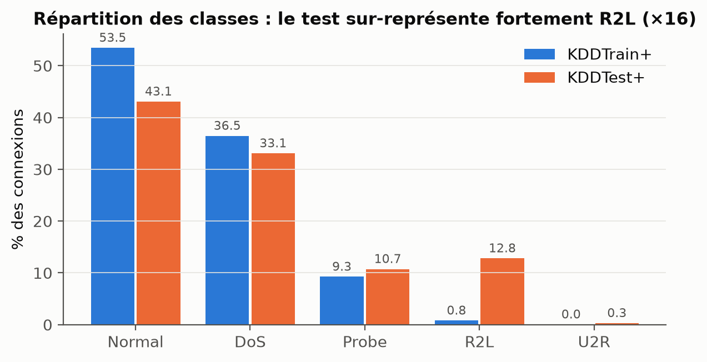
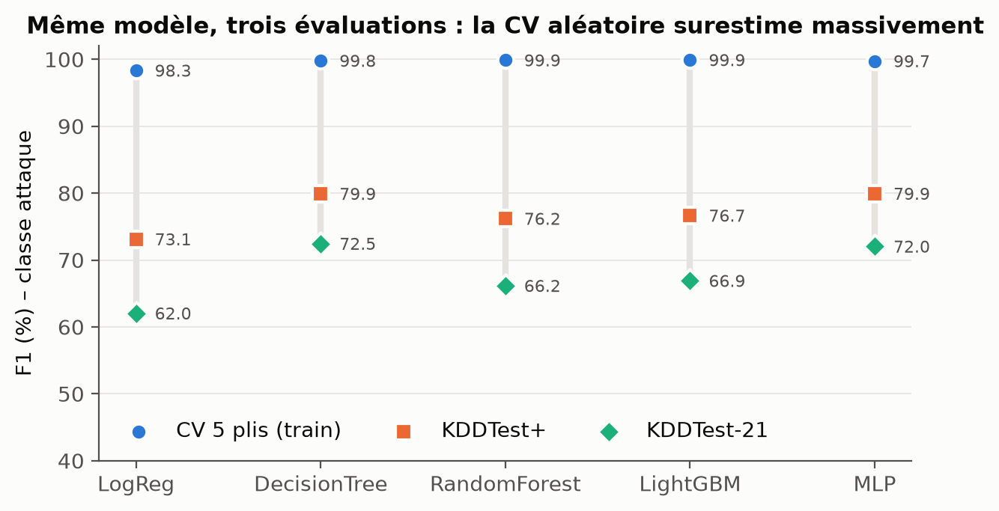
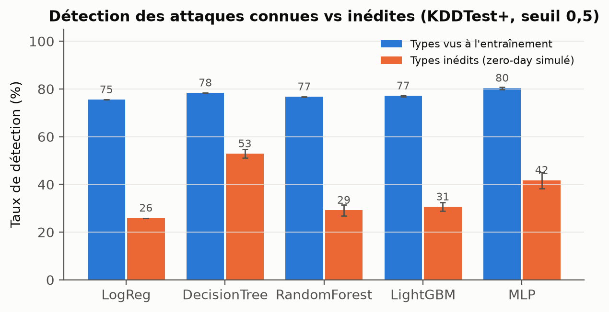
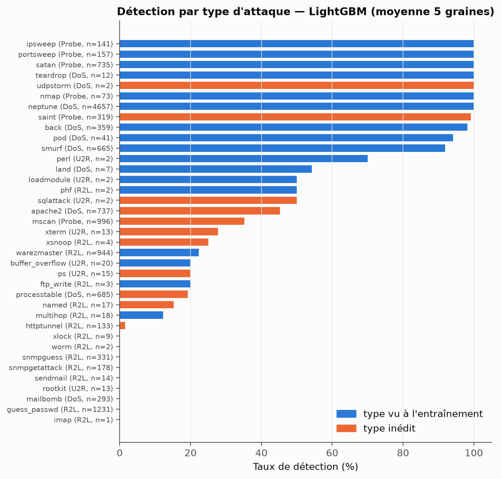
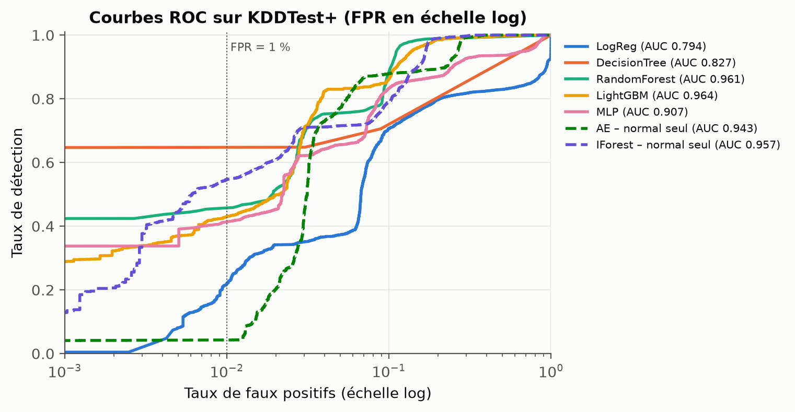
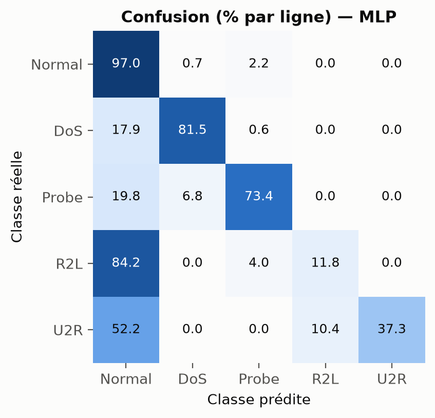
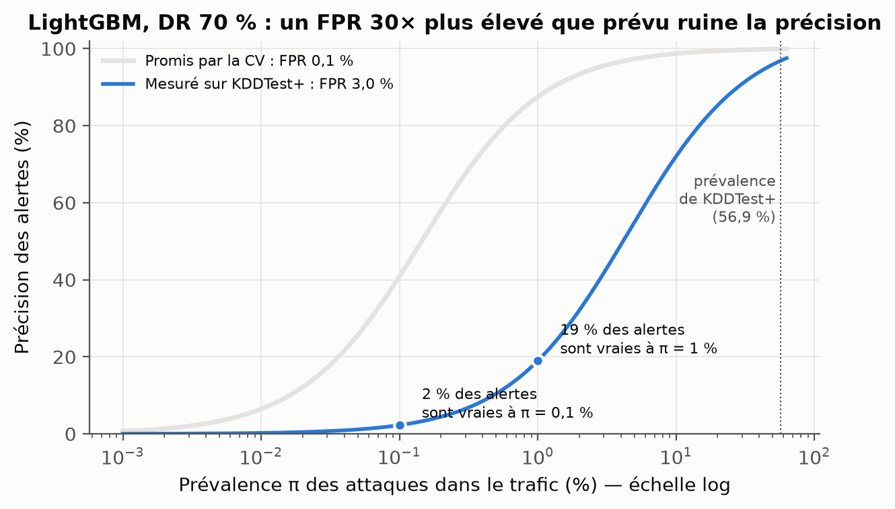
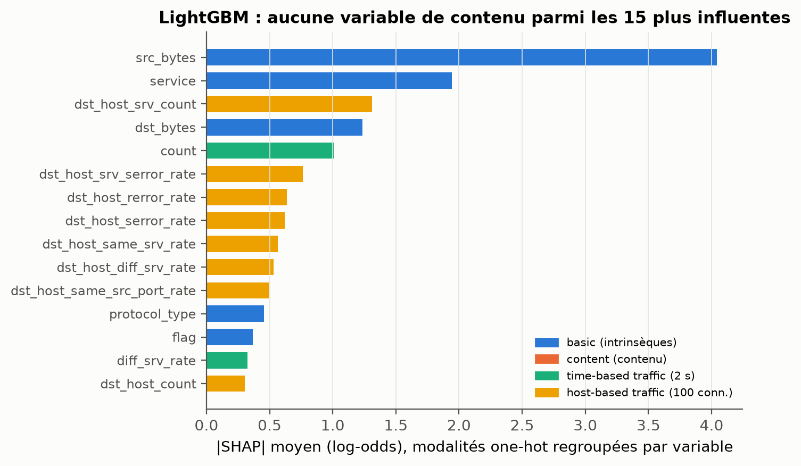

# Détection d'intrusions par apprentissage automatique sur NSL-KDD
## Une évaluation sous décalage de distribution et face aux attaques inédites

*Rapport technique — octobre 2026*

---

## Résumé

Les travaux de détection d'intrusions (IDS) fondés sur l'apprentissage automatique annoncent
couramment des performances supérieures à 99 % sur le jeu de données NSL-KDD. Ce rapport montre
que ces chiffres proviennent presque toujours d'une validation croisée aléatoire sur l'ensemble
d'entraînement, et qu'ils ne décrivent pas ce qui se passe lorsque le modèle rencontre un trafic
différent de celui qu'il a appris.

Nous avons entraîné cinq classifieurs supervisés (régression logistique, arbre de décision,
forêt aléatoire, LightGBM, perceptron multicouche) et deux détecteurs d'anomalies
(auto-encodeur, Isolation Forest), selon un protocole conçu pour éviter toute fuite
d'information du test vers l'apprentissage. Les principaux résultats sont les suivants :

1. **La validation croisée surestime massivement la performance.** Le F1 passe de 98,3–99,9 %
   en validation croisée à 73,1–79,9 % sur KDDTest+ et 62,1–72,5 % sur KDDTest-21, soit une
   perte de 20 à 36 points.
2. **Les attaques inédites sont mal détectées.** 29,2 % des attaques du test appartiennent à
   des types absents de l'entraînement ; elles sont détectées à 26–53 %, contre 75–80 % pour
   les types connus.
3. **Le taux de faux positifs ne se transfère pas.** Un seuil réglé pour 0,1 % de fausses
   alarmes sur l'entraînement en produit 3,0 % sur le test (×30). Dans un réseau où 1 % des
   connexions sont malveillantes, seules 19 % des alertes seraient alors vraies.
4. **Un détecteur hybride aide.** Combiner LightGBM et Isolation Forest double presque la
   détection des attaques inédites (30,6 % → 59,1 %) pour un coût en faux positifs faible
   (2,8 % → 3,1 %).
5. **Les modèles s'appuient sur des variables de trafic, pas de contenu.** Les variables de
   contenu ne représentent que 3,1 % de l'importance SHAP ; retirer les variables « host-based »
   *améliore* la détection des attaques inédites (29,9 % → 56,1 %).

L'ensemble des chiffres est produit par des scripts ; un script de contrôle
(`99_verify_report.py`) les recalcule et les compare aux valeurs citées.

---

## 1. Introduction

### 1.1 Contexte

Un système de détection d'intrusions réseau observe les connexions et doit signaler celles qui
relèvent d'une attaque. L'apprentissage automatique est une approche naturelle : on apprend, à
partir de connexions étiquetées, à séparer le trafic normal du trafic malveillant.

La difficulté propre à la sécurité est que **l'adversaire évolue**. Un modèle déployé verra des
attaques qui n'existaient pas lors de son entraînement, dans un trafic dont la composition
change. Une évaluation honnête doit donc mesurer non seulement la capacité à reconnaître ce qui
a été appris, mais aussi la capacité à **généraliser** à un trafic différent.

### 1.2 Questions de recherche

Le travail est organisé autour de six questions :

| # | Question |
|---|---|
| Q1 | Quel est l'écart entre la performance mesurée en validation croisée et la performance sur un ensemble de test réellement distinct ? |
| Q2 | Les modèles détectent-ils les types d'attaques absents de l'entraînement (« zero-day » simulés) ? |
| Q3 | Un seuil de décision réglé sur l'entraînement conserve-t-il son taux de faux positifs sur le test, et quelles en sont les conséquences opérationnelles ? |
| Q4 | Des détecteurs d'anomalies appris sur le trafic normal seul, ou un détecteur hybride, détectent-ils mieux les attaques inédites ? |
| Q5 | Peut-on prédire, à partir de l'entraînement seul, quel modèle détectera le mieux les attaques inédites ? |
| Q6 | Sur quelles variables les modèles fondent-ils leurs décisions, et certaines nuisent-elles à la généralisation ? |

---

## 2. Données

### 2.1 Le jeu NSL-KDD

NSL-KDD (Tavallaee et al., 2009) est une version nettoyée de KDD Cup 99, elle-même issue des
campagnes d'évaluation DARPA 1998/1999. Chaque ligne décrit une connexion par 41 variables,
réparties en quatre groupes :

| Groupe | Variables | Exemples |
|---|---|---|
| *basic* (intrinsèques) | 9 | `duration`, `protocol_type`, `service`, `flag`, `src_bytes` |
| *content* (contenu) | 13 | `num_failed_logins`, `root_shell`, `num_file_creations` |
| *time-based traffic* (fenêtre de 2 s) | 9 | `count`, `serror_rate`, `same_srv_rate` |
| *host-based traffic* (100 dernières connexions) | 10 | `dst_host_count`, `dst_host_srv_serror_rate` |

Chaque connexion porte une étiquette (« normal » ou le nom de l'attaque) et un niveau de
difficulté. Les attaques sont regroupées en quatre catégories selon la taxonomie DARPA :
**DoS** (déni de service), **Probe** (reconnaissance), **R2L** (accès distant non autorisé) et
**U2R** (élévation de privilèges).

Trois fichiers sont utilisés ; leurs empreintes SHA-256 ont été vérifiées avant toute analyse.

| Fichier | Connexions | Types d'attaques | Normal | DoS | Probe | R2L | U2R |
|---|---:|---:|---:|---:|---:|---:|---:|
| KDDTrain+ | 125 973 | 22 | 67 343 | 45 927 | 11 656 | 995 | 52 |
| KDDTest+ | 22 544 | 37 | 9 711 | 7 458 | 2 421 | 2 887 | 67 |
| KDDTest-21 | 11 850 | 37 | 2 152 | 4 342 | 2 402 | 2 887 | 67 |

KDDTest-21 est le sous-ensemble de KDDTest+ formé des connexions de difficulté < 21, c'est-à-dire
celles que les 21 classifieurs de référence de Tavallaee et al. n'ont pas tous classées
correctement. C'est la version « difficile » du test.

### 2.2 Diagnostic préalable (script `01_eda.py`)

Avant toute modélisation, nous avons examiné les données pour savoir à quoi s'attendre.

**Décalage de la répartition des classes.** La composition du test est très différente de celle
de l'entraînement (figure 1). R2L passe de 0,8 % à 12,8 % des connexions (×16), U2R de 0,04 % à
0,3 %. Un modèle qui a vu 995 exemples R2L devra en classer 2 887.



*Figure 1 — Part de chaque classe dans KDDTrain+ et KDDTest+.*

**Attaques inédites.** 17 types d'attaques n'apparaissent que dans le test : `apache2`,
`httptunnel`, `mailbomb`, `mscan`, `named`, `processtable`, `ps`, `saint`, `sendmail`,
`snmpgetattack`, `snmpguess`, `sqlattack`, `udpstorm`, `worm`, `xlock`, `xsnoop`, `xterm`.
Ils représentent **3 750 connexions, soit 29,2 % des attaques de KDDTest+** et 38,6 % de celles
de KDDTest-21. Leur poids varie selon la catégorie : 23 % des DoS, 54 % des Probe, 24 % des R2L
et 45 % des U2R du test sont inédits. Ces connexions constituent un banc d'essai naturel pour
les « zero-day ».

**Validation adversariale.** Pour mesurer le décalage de distribution des variables, nous avons
entraîné un classifieur (HistGradientBoosting, validation croisée à 5 plis) à deviner si une
connexion provient du train ou du test. Si les deux ensembles suivaient la même distribution,
l'AUC serait proche de 0,5.

| Population | AUC train vs test |
|---|---:|
| Toutes les connexions | **0,910** |
| Trafic normal uniquement | **0,801** |

Le classifieur distingue très bien les deux ensembles, **y compris sur le trafic normal**. Le
décalage ne vient donc pas seulement des nouvelles attaques : le trafic légitime lui-même a
changé. Un modèle pourra produire des faux positifs sur un trafic normal qu'il n'a jamais vu.

**Qualité des données.**
- aucun doublon exact dans KDDTrain+ (c'est l'apport de NSL-KDD par rapport à KDD 99) ;
- 7 vecteurs de variables identiques portent des catégories différentes (bruit d'étiquetage,
  négligeable) ;
- `num_outbound_cmds` est constante (toujours 0) et n'apporte aucune information ;
- 664 connexions du test sont identiques à une connexion du train ;
- tous les services du test existent dans le train ;
- difficulté moyenne : 19,5 dans le train, 18,0 dans le test.

**Conséquence pour la suite.** Ce diagnostic prédit que la validation croisée sur le train,
qui mélange des connexions de même distribution, sera optimiste. Le reste du protocole est
construit pour mesurer précisément cet écart.

---

## 3. Méthodologie

### 3.1 Garde-fous contre la fuite d'information

Une évaluation n'a de valeur que si aucune information du test n'a influencé le modèle. Quatre
règles ont été appliquées :

1. **Prétraitement appris sur le train seul.** Encodage et normalisation sont inclus dans un
   `sklearn.Pipeline` ajusté sur KDDTrain+, puis appliqués tels quels au test.
2. **La colonne `difficulty` n'est jamais une variable explicative.** Elle est calculée à
   partir des prédictions de 21 classifieurs sur l'étiquette ; l'utiliser reviendrait à donner
   au modèle une partie de la réponse.
3. **Aucune décision prise sur le test.** Seuils, choix du modèle retenu et référence des tests
   statistiques sont fixés sur le train (prédictions hors-pli de la validation croisée, ou
   validation interne).
4. **Évaluation désagrégée.** Les résultats sont donnés séparément pour les attaques vues et
   inédites, par type d'attaque, et sur KDDTest+ et KDDTest-21.

### 3.2 Prétraitement (`nslkdd.py`)

- **Variables catégorielles** (`protocol_type`, `service`, `flag`) : encodage one-hot ; une
  modalité inconnue au test serait ignorée (`handle_unknown="ignore"`).
- **Variables numériques à queue lourde** (volumes d'octets, compteurs, 16 variables) :
  transformation `log1p`, qui ramène des valeurs allant de 0 à plusieurs millions sur une
  échelle comparable.
- **Toutes les variables numériques** : centrage-réduction (`StandardScaler`).

Après encodage, chaque connexion est représentée par **122 variables**.

### 3.3 Modèles (`models.py`)

Les hyperparamètres sont fixés *a priori* à des valeurs usuelles et documentées ; ils n'ont
pas été optimisés sur le test.

| Modèle | Famille | Paramètres principaux | Pourquoi ce modèle |
|---|---|---|---|
| LogReg | linéaire | C = 1, lbfgs | référence simple et interprétable |
| DecisionTree | arbre | `min_samples_leaf = 2` | règles explicites, proche des signatures |
| RandomForest | ensemble d'arbres | 300 arbres | référence robuste de la littérature IDS |
| LightGBM | gradient boosting | 400 arbres, lr 0,05, 31 feuilles | état de l'art sur données tabulaires |
| MLP | réseau de neurones | couches 128-64, early stopping | approche « apprentissage profond » courante |

Deux détecteurs d'anomalies **semi-supervisés** sont entraînés sur le trafic normal seul :
- **auto-encodeur** (MLP 64-16-64) : il apprend à reconstruire le trafic normal ; une erreur de
  reconstruction élevée signale une anomalie ;
- **Isolation Forest** (300 arbres) : une connexion facile à isoler par des coupures aléatoires
  est jugée anormale.

Ces détecteurs n'ont jamais vu d'attaque : ils sont, par construction, candidats à la détection
de ce qui est nouveau. Leur seuil est fixé pour obtenir **1 % de fausses alarmes** sur 20 % du
trafic normal du train mis de côté.

Un **détecteur hybride** déclenche une alerte si le classifieur supervisé **ou** le détecteur
d'anomalies en déclenche une.

### 3.4 Protocole expérimental (`02_experiments.py`)

| Expérience | Données d'apprentissage | Données d'évaluation | Répétitions |
|---|---|---|---|
| Validation croisée | KDDTrain+ (5 plis stratifiés sur les 5 classes) | pli tenu à l'écart | graine 0 |
| Binaire (normal / attaque) | KDDTrain+ complet | KDDTest+, KDDTest-21 | 5 graines |
| Multi-classe (5 classes), avec et sans pondération des classes | KDDTrain+ complet | KDDTest+, KDDTest-21 | 5 graines |
| Détection d'anomalies | 80 % du trafic normal du train | KDDTest+ | 5 graines |

La régression logistique est déterministe : une seule graine suffit. Les cinq graines des autres
modèles permettent de séparer un effet réel d'une fluctuation due à l'initialisation.

### 3.5 Métriques et tests statistiques (`03_analysis.py`)

- **Métriques binaires** : exactitude, précision, rappel (= taux de détection, DR), F1, taux de
  faux positifs (FPR), coefficient de Matthews (MCC), ROC-AUC et PR-AUC.
- **Métriques multi-classes** : exactitude, F1 macro (chaque classe compte autant, quelle que
  soit sa taille) et rappel par classe.
- **Incertitude** : moyenne ± écart-type sur les 5 graines ; intervalle de confiance à 95 % par
  bootstrap (300 rééchantillonnages du test, graine 0).
- **Comparaison de modèles** : test exact de McNemar (qui compare les erreurs de deux modèles
  sur les mêmes connexions), avec correction de Holm pour les comparaisons multiples.
- **Calibration** : erreur de calibration attendue (ECE, 15 intervalles) et score de Brier. Un
  modèle calibré qui annonce 80 % de probabilité d'attaque doit avoir raison 80 % du temps.

### 3.6 Analyses complémentaires

- **Leave-attack-out** (`04_leave_attack_out.py`) : pour chacun des 16 types d'attaques du train
  ayant au moins 10 exemples, on réentraîne le modèle *sans aucun exemple de ce type*, puis on
  mesure s'il le détecte. C'est une simulation de zero-day qui n'utilise que le train.
- **Explicabilité** (`05_explain_ablation.py`) : valeurs SHAP de LightGBM sur 4 000 connexions
  du test, puis ablation (on retire un groupe de variables à la fois et on réentraîne
  LightGBM, 3 graines).
- **Ablation par type** (`06_host_ablation_per_type.py`) : effet, type d'attaque par type
  d'attaque, du retrait des variables *host-based*.

### 3.7 Environnement d'exécution

Les résultats présentés ici sont ceux d'une **reproduction complète** réalisée le 22 octobre
2026 sur Windows 11 (8 cœurs, Python 3.12) avec les versions de `requirements.txt`
(scikit-learn 1.9.1, LightGBM 4.7.0, SHAP 0.54.1). La reproduction a duré 71 minutes, dont
53 pour `02_experiments.py`. La section 5 la compare à l'exécution d'origine.

---

## 4. Résultats

### 4.1 Q1 — L'illusion de la validation croisée

**Tableau 1 — Classification binaire : F1 et taux de faux positifs (%) selon l'évaluation**
(moyenne ± écart-type sur 5 graines)

| Modèle | F1 CV | F1 KDDTest+ | F1 KDDTest-21 | FPR CV | FPR KDDTest+ | ROC-AUC KDDTest+ |
|---|---:|---:|---:|---:|---:|---:|
| LogReg | 98,34 | 73,13 | 62,05 | 1,28 | 7,63 | 79,41 |
| DecisionTree | 99,81 | **79,92 ± 0,44** | **72,46 ± 0,61** | 0,20 | 8,60 | 82,89 |
| RandomForest | 99,88 | 76,19 ± 0,51 | 66,16 ± 0,78 | 0,06 | **2,70** | 96,17 |
| LightGBM | **99,92** | 76,66 ± 0,51 | 66,91 ± 0,77 | **0,04** | 2,81 | **96,66** |
| MLP | 99,75 | **79,93 ± 1,09** | 72,04 ± 1,52 | 0,16 | 4,91 | 91,57 |



*Figure 2 — F1 du même modèle sous trois évaluations.*

**Observations.**
- Tous les modèles dépassent 98 % en validation croisée, puis perdent **19,8 à 25,2 points**
  sur KDDTest+ et **27,3 à 36,3 points** sur KDDTest-21.
- Le FPR est multiplié par 6 à 70 : LightGBM passe de 0,04 % à 2,81 %, l'arbre de 0,20 % à
  8,60 %.
- **La validation croisée ne permet pas non plus de classer les modèles.** LightGBM est le
  meilleur en CV mais seulement troisième en F1 sur le test, derrière le MLP et l'arbre. La corrélation de rang de Spearman
  entre le classement CV et le classement test est de 0,10 (0,20 lors de l'exécution
  d'origine) : elle est pratiquement nulle. Avec cinq modèles, ce coefficient n'est pas
  significatif et ne doit être lu que comme une indication.
- F1 et ROC-AUC racontent des histoires différentes : l'arbre a le meilleur F1 mais un AUC
  médiocre (82,9 %), car il produit des scores presque binaires ; LightGBM et RandomForest ont
  un AUC de 96–97 % mais un seuil de 0,5 mal adapté au test.

**Interprétation.** La validation croisée aléatoire tire ses plis de la même distribution que
l'entraînement : elle mesure la capacité à *reconnaître* des connexions semblables à celles déjà
vues, presque parfaite ici. Le test, issu d'une distribution différente (AUC adversariale 0,91)
et contenant 29 % d'attaques inédites, mesure la capacité à *généraliser*. C'est la seconde qui
compte en production.

### 4.2 Q2 — Attaques connues contre attaques inédites



*Figure 3 — Taux de détection sur KDDTest+ (seuil 0,5), selon que le type d'attaque a été vu à
l'entraînement ou non.*

| Modèle | DR types vus (%) | DR types inédits (%) | Écart (pts) |
|---|---:|---:|---:|
| LogReg | 75,5 | 25,9 | 49,6 |
| DecisionTree | 78,3 | **52,8** | 25,5 |
| RandomForest | 76,7 | 29,1 | 47,6 |
| LightGBM | 77,1 | 30,6 | 46,5 |
| MLP | **80,3** | 41,7 | 38,6 |

Les types inédits sont détectés **1,5 à 3 fois moins bien** que les types connus. Les
modèles les plus puissants en validation croisée (RandomForest, LightGBM) sont parmi les moins
bons sur l'inédit : ils s'ajustent finement à ce qu'ils ont vu, ce qui les rend précis sur le
connu et aveugles au nouveau. L'arbre de décision, plus grossier, généralise mieux.

Même les types « vus » ne sont détectés qu'à 75–80 %. La figure 6 montre pourquoi.



*Figure 6 — Taux de détection par type d'attaque, LightGBM (modèle retenu par la CV), moyenne
de 5 graines. En orange : types inédits.*

- **Les DoS et Probe connus sont détectés à 92–100 %** (`neptune`, `satan`, `ipsweep`,
  `portsweep`, `smurf`, `back`…), à l'exception de `land` (54 %, 7 connexions seulement).
- **Les R2L connus sont presque tous manqués.** `guess_passwd` compte 53 exemples dans le train
  mais 1 231 dans le test, et n'est jamais détecté ; `warezmaster` (20 exemples dans le train,
  944 dans le test) l'est à 22 %. Ces attaques « vues » sont si rares à l'entraînement que leur
  forme dans le test ne ressemble pas à ce que le modèle a appris : elles se comportent en
  pratique comme des attaques inédites.
- **Parmi les inédits**, `saint` (99 %) et `udpstorm` sont détectés, car ils ressemblent à des
  attaques connues (`saint` est proche de `satan`). En revanche `mailbomb`, `snmpguess`,
  `snmpgetattack` (0 %), `processtable` (19 %) et `mscan` (35 %) passent largement inaperçus.

### 4.3 Comparaison statistique des modèles

**Intervalles de confiance à 95 % (bootstrap, graine 0, KDDTest+)**

| Modèle | F1 | ROC-AUC |
|---|---|---|
| LogReg | [72,5 ; 73,7] | [78,8 ; 80,0] |
| DecisionTree | [79,1 ; 80,2] | [82,2 ; 83,1] |
| RandomForest | [74,7 ; 76,0] | [95,9 ; 96,3] |
| LightGBM | [76,9 ; 78,1] | [96,2 ; 96,6] |
| MLP | [78,1 ; 79,2] | [90,2 ; 91,1] |

**Test de McNemar par rapport à LightGBM** (modèle retenu par la validation croisée, graine 0)

| Modèle comparé | LightGBM juste, l'autre faux | LightGBM faux, l'autre juste | p (Holm) | Conclusion |
|---|---:|---:|---:|---|
| LogReg | 1 434 | 512 | 4·10⁻¹⁰⁰ | LightGBM meilleur |
| RandomForest | 596 | 244 | 3·10⁻³⁴ | LightGBM meilleur |
| DecisionTree | 911 | 1 098 | 7·10⁻⁵ | **l'arbre est meilleur** |
| MLP | 710 | 775 | 0,097 | pas de différence significative |

La référence est le modèle choisi par validation croisée, et non le meilleur sur le test :
choisir la référence en regardant le test serait une décision prise sur le test, et ce choix
serait de plus instable (l'arbre et le MLP sont départagés par 0,01 point de F1).

Le test confirme que **le modèle retenu par la CV est significativement battu par l'arbre de
décision sur le test**, et qu'il ne se distingue pas du MLP. Les écarts entre modèles,
quelques points, sont faibles devant l'écart CV-test (20 à 36 points) : le choix du protocole
d'évaluation pèse bien plus que le choix du modèle.

### 4.4 Courbes ROC et calibration



*Figure 4 — Courbes ROC sur KDDTest+ (graine 0), taux de faux positifs en échelle logarithmique
pour se concentrer sur la zone utile en exploitation.*

L'échelle logarithmique est indispensable : un IDS est utilisé à des FPR de l'ordre de 0,1 à
1 %, zone écrasée à gauche d'une courbe ROC classique. À **FPR = 1 %**, Isolation Forest, appris
sans aucune attaque, atteint environ 55 % de détection, plus que tous les modèles supervisés
sauf l'arbre (~65 %).

**Calibration.**

| Modèle | ECE en CV | ECE sur KDDTest+ | Brier KDDTest+ |
|---|---:|---:|---:|
| LogReg | 0,0046 | 0,244 | 0,238 |
| DecisionTree | 0,0012 | 0,183 | 0,193 |
| RandomForest | 0,0022 | 0,192 | 0,166 |
| LightGBM | 0,0004 | 0,214 | 0,202 |
| MLP | 0,0008 | 0,186 | 0,182 |

Les modèles sont presque parfaitement calibrés en validation croisée (ECE < 0,5 %), puis
**l'erreur de calibration est multipliée par 50 à 500** sur le test (18–24 %). Les
probabilités produites ne peuvent donc pas être interprétées comme des niveaux de confiance
dès que le trafic change.

### 4.5 Classification multi-classe

**Tableau 2 — Classification en 5 classes sur KDDTest+** (moyenne de 5 graines)

| Modèle | Exactitude | F1 macro | Rappel Normal | Rappel DoS | Rappel Probe | Rappel R2L | Rappel U2R |
|---|---:|---:|---:|---:|---:|---:|---:|
| LogReg | 74,0 | 51,8 | 92,3 | 79,6 | 70,5 | 2,5 | 11,9 |
| LogReg (pondéré) | 76,7 | 59,4 | 90,5 | 79,7 | **78,1** | **22,2** | **49,3** |
| DecisionTree | 76,7 | 56,2 | 97,2 | 83,0 | 61,3 | 5,6 | 19,7 |
| RandomForest | 74,5 | 49,8 | **97,4** | 77,2 | 60,4 | 3,9 | 4,2 |
| LightGBM | 74,3 | 51,7 | 96,0 | 77,8 | 60,1 | 5,4 | 13,4 |
| LightGBM (pondéré) | 77,7 | 58,5 | 97,1 | **83,2** | 66,6 | 8,5 | 23,0 |
| MLP | **78,2** | **61,1** | 97,0 | 81,9 | 68,2 | 15,1 | 23,6 |



*Figure 5 — Matrice de confusion normalisée par ligne du MLP (meilleur F1 macro), graine 0.*

- **R2L et U2R sont les classes perdues** : 84 % des R2L et 52 % des U2R sont classés
  « Normal » par le MLP. C'est la conséquence directe de leur rareté à l'entraînement (995 et
  52 exemples) et de leur ressemblance avec des connexions légitimes (une tentative de mot de
  passe ressemble à une connexion normale).
- **Pondérer les classes** (`class_weight="balanced"`) améliore nettement LogReg et LightGBM
  (+7 points de F1 macro) en forçant le modèle à prêter attention aux classes rares, mais
  aide peu la forêt aléatoire (+1 point) et dégrade l'arbre de décision (−4 points).
- Même dans le meilleur cas, le rappel R2L ne dépasse pas 22 %.

*Remarque :* la figure 5 présente le modèle ayant le meilleur F1 macro **sur le test** ; c'est
un choix de présentation, pas de sélection de modèle.

### 4.6 Q4 — Détection d'anomalies et détecteur hybride

**Tableau 3 — Détecteurs d'anomalies et hybrides sur KDDTest+** (moyenne de 5 graines ; seuil
d'anomalie fixé à 1 % de FPR sur le trafic normal de validation)

| Détecteur | DR global | DR types vus | DR types inédits | FPR test | F1 |
|---|---:|---:|---:|---:|---:|
| Auto-encodeur seul | 4,3 | 5,6 | 0,9 | 0,9 | — |
| Isolation Forest seul | 60,2 | 62,8 | 53,8 | 1,8 | — |
| LightGBM seul | 63,5 | 77,1 | 30,6 | 2,8 | 76,7 |
| **LightGBM + Isolation Forest** | **72,2** | 77,6 | **59,1** | **3,1** | **82,7** |
| LightGBM + auto-encodeur | 67,6 | 82,5 | 31,3 | 3,5 | 79,4 |
| RandomForest + Isolation Forest | 71,9 | 77,2 | 58,8 | 3,0 | 82,5 |
| MLP + Isolation Forest | 75,2 | 80,8 | 61,5 | 5,2 | 83,9 |

**Observations.**
- **L'auto-encodeur échoue à seuil fixé** malgré un bon AUC (0,94) : au seuil de 1 % de FPR, il
  ne détecte que 4 % des attaques. Un bon AUC ne garantit pas une bonne détection au point de
  fonctionnement voulu.
- **Isolation Forest détecte 54 % des attaques inédites sans en avoir jamais vu**, presque deux
  fois plus que LightGBM, et son FPR (1,8 %) reste proche de l'objectif de 1 %.
- **L'hybride LightGBM + Isolation Forest combine les deux forces** : il garde la précision du
  supervisé sur le connu et récupère l'inédit grâce au détecteur d'anomalies. Le DR sur les
  inédits passe de 30,6 % à 59,1 % (+28,5 points) pour seulement +0,26 point de FPR, et le F1
  passe de 76,7 à 82,7.

### 4.7 Q3 — Transfert du point de fonctionnement et taux de base

En exploitation, on ne choisit pas le seuil 0,5 : on règle le seuil pour un budget de fausses
alarmes. Nous avons fixé ce seuil sur les prédictions hors-pli du train, puis mesuré le FPR
obtenu sur le test.

| Modèle | FPR visé (train) | FPR obtenu (test) | Facteur | DR (test) |
|---|---:|---:|---:|---:|
| LightGBM | 1 % | 6,15 % | ×6 | 84,7 % |
| LightGBM | 0,1 % | 3,01 % | **×30** | 69,7 % |
| RandomForest | 0,1 % | 2,92 % | ×29 | 68,1 % |
| MLP | 0,1 % | 4,19 % | ×41 | 67,1 % |
| LogReg | 0,1 % | 6,50 % | ×64 | 42,5 % |

*Cas particulier :* l'arbre de décision produit des scores discrets. Pour un objectif de 0,1 %,
aucun seuil intermédiaire n'existe et le seuil retenu dépasse le score maximal : le modèle ne
signale plus rien (DR = 0). Un modèle à scores discrets se prête mal au réglage fin du FPR.

**Pourquoi c'est grave : le taux de base.** La précision des alertes, c'est-à-dire la part des
alertes qui correspondent réellement à une attaque, dépend de la prévalence π des attaques dans
le trafic :

$$\text{précision} = \frac{\text{DR}\cdot\pi}{\text{DR}\cdot\pi + \text{FPR}\cdot(1-\pi)}$$

Dans un vrai réseau, π est très faible (une connexion sur cent, ou sur mille, est malveillante).



*Figure 7 — Précision des alertes de LightGBM (seuil réglé pour 0,1 % de FPR sur le train)
en fonction de la prévalence des attaques. Courbe grise : FPR promis par la CV ; courbe bleue :
FPR mesuré sur le test. La ligne pointillée marque la prévalence des attaques dans KDDTest+
(56,9 %), calculée à partir des données : c'est la situation dans laquelle le détecteur a été
évalué.*

| Prévalence π | Précision promise par la CV (FPR 0,1 %) | Précision réelle (FPR 3,0 %) |
|---:|---:|---:|
| 10 % | ≈ 99 % | 72,0 % |
| 1 % | ≈ 87 % | 18,9 % |
| 0,1 % | ≈ 41 % | **2,3 %** |

À π = 0,1 %, **97,7 % des alertes seraient des fausses alarmes**, soit environ
**30 000 fausses alertes par million de connexions**. Un analyste noyé dans ce volume finit par
ignorer les alertes : c'est le « paradoxe du taux de base » décrit par Axelsson (2000). L'écart
entre FPR promis et FPR réel, invisible en validation croisée, change complètement l'utilité
opérationnelle du détecteur.

À la prévalence du test lui-même (56,9 %), la précision atteint 97 % : c'est ce chiffre que
mesure implicitement une évaluation sur KDDTest+, et il n'a rien à voir avec ce qu'un analyste
observerait sur un réseau réel.

*Correction :* dans la version d'origine de la figure, la ligne de prévalence était codée en
dur à 43,08 %, qui est la part du trafic **normal** et non celle des attaques. Elle est
désormais calculée à partir des étiquettes du test (`y.mean()`), et la plage de la courbe a été
étendue jusqu'à 63 % pour la couvrir. Les chiffres de précision ci-dessus ne sont pas affectés.

### 4.8 Q5 — Peut-on prédire la détection des inédits depuis le train ?

Le protocole *leave-attack-out* retire un type d'attaque du train et vérifie si le modèle le
détecte quand même. Si cette simulation était fiable, elle permettrait de choisir le modèle le
plus robuste aux zero-day **sans regarder le test**.

**Tableau 4 — Détection d'un type d'attaque retiré de l'entraînement** (extraits, graine 0)

| Type retiré | Catégorie | n | LogReg | DecisionTree | RandomForest | LightGBM | MLP |
|---|---|---:|---:|---:|---:|---:|---:|
| neptune | DoS | 41 214 | 0,69 | 0,89 | 0,71 | 0,88 | 0,96 |
| smurf | DoS | 2 646 | 0,58 | 0,00 | 0,00 | 0,00 | 0,00 |
| back | DoS | 956 | 0,00 | 0,05 | 0,00 | 0,00 | 0,00 |
| teardrop | DoS | 892 | 1,00 | 1,00 | 0,87 | 1,00 | 1,00 |
| portsweep | Probe | 2 931 | 0,99 | 0,42 | 0,78 | 0,96 | 0,61 |
| guess_passwd | R2L | 53 | 0,55 | 1,00 | 0,00 | 0,02 | 0,08 |
| warezclient | R2L | 890 | 0,02 | 0,00 | 0,00 | 0,00 | 0,01 |
| warezmaster | R2L | 20 | 0,00 | 0,35 | 0,50 | 0,95 | 0,40 |
| **Moyenne (16 types)** | | | **0,560** | 0,544 | 0,420 | 0,544 | 0,465 |

Le FPR sur le trafic normal mis de côté reste faible (0,05 % à 1,5 %).

| Classement des modèles selon… | 1er | 2e | 3e | 4e | 5e |
|---|---|---|---|---|---|
| Leave-attack-out (train) | LogReg | DecisionTree | LightGBM | MLP | RandomForest |
| DR des inédits sur le test | DecisionTree | MLP | LightGBM | RandomForest | LogReg |

La corrélation de Spearman entre les deux classements est de **−0,10** ; celle entre le F1 en
CV et la détection des inédits est de 0,20. **Aucune des deux méthodes fondées sur le train ne
prédit quel modèle détectera le mieux les vraies attaques inédites.** LogReg, premier en
leave-attack-out, est dernier sur le test.

Explication probable : les attaques retirées du train restent issues de la même campagne de
capture que les autres données d'entraînement (même réseau, même période), alors que les
attaques inédites du test viennent d'une distribution décalée (§ 2.2). Simuler la nouveauté de
l'attaque ne simule pas le changement d'environnement. Ces corrélations portent sur cinq
modèles seulement et restent indicatives.

### 4.9 Q6 — Explicabilité et ablation des variables



*Figure 8 — Importance SHAP moyenne des 15 variables les plus influentes pour LightGBM (binaire,
4 000 connexions du test). Les modalités one-hot sont regroupées par variable d'origine.*

**Part de l'importance SHAP par groupe de variables**

| Groupe | Part |
|---|---:|
| basic (intrinsèques) | 49,1 % |
| host-based traffic | 33,6 % |
| time-based traffic | 14,2 % |
| content (contenu) | **3,1 %** |

Les variables les plus influentes sont `src_bytes`, `service`, `dst_host_srv_count`,
`dst_bytes` et `count`. **Aucune variable de contenu ne figure parmi les 15 premières.** Or ce
sont justement les variables de contenu (tentatives de connexion échouées, obtention d'un shell
root, création de fichiers) qui caractérisent les attaques R2L et U2R. Le modèle a appris à
reconnaître des *motifs de trafic*, efficaces pour les DoS et les Probe qui génèrent beaucoup
de connexions, mais inopérants pour les attaques discrètes.

**Attaques inédites manquées.** Parmi les inédits non détectés, les plus fréquents sont `mscan`
(627), `processtable` (569), `snmpguess` (331), `mailbomb` (293) et `apache2` (232). Les
variables qui « rassurent » le plus le modèle sur ces connexions (contribution SHAP moyenne la
plus négative) sont `count`, `dst_host_same_src_port_rate` et `dst_host_serror_rate` : le
modèle les juge normales parce que leur volume et leur taux d'erreur ressemblent à du trafic
légitime.

**Tableau 5 — Ablation : LightGBM réentraîné sans un groupe de variables** (moyenne de 3 graines,
KDDTest+)

| Groupe retiré | F1 | ROC-AUC | DR vus | DR inédits | FPR |
|---|---:|---:|---:|---:|---:|
| aucun (référence) | 76,5 | 96,5 | 77,1 | 29,9 | 2,8 |
| basic | 73,5 | 94,2 | 77,0 | 21,9 | 6,3 |
| content | 77,4 | 96,6 | 76,8 | 34,3 | 2,8 |
| time-based | 76,7 | 96,5 | 76,3 | 32,4 | 2,9 |
| **host-based** | **81,0** | 96,6 | 75,8 | **56,1** | 3,8 |

*Note :* la référence de l'ablation (F1 76,5) diffère légèrement du LightGBM principal (76,7)
parce que le prétraitement de l'ablation n'applique pas la transformation `log1p`.

**Le résultat le plus surprenant de l'étude : retirer les 10 variables host-based améliore la
détection des inédits de 26 points** (29,9 % → 56,1 %) et le F1 de 4,5 points, au prix d'une
légère hausse du FPR (+1 point).

L'ablation type par type (`06_host_ablation_per_type.py`) explique ce gain :

| Type d'attaque | Inédit | n | DR avec host-based | DR sans host-based |
|---|---|---:|---:|---:|
| snmpguess | oui | 331 | 0,00 | **0,88** |
| mscan | oui | 996 | 0,34 | **0,78** |
| apache2 | oui | 737 | 0,57 | **0,89** |
| buffer_overflow | non | 20 | 0,20 | 0,75 |
| processtable | oui | 685 | 0,18 | **0,02** |
| warezmaster | non | 944 | 0,23 | **0,00** |

Les variables host-based résument les 100 dernières connexions vers le même hôte. Elles
dépendent donc fortement de la topologie et de l'activité du réseau au moment de la capture,
qui ont changé entre le train et le test (§ 2.2). Le modèle s'en sert comme raccourci : sur
le train, elles séparent très bien les classes ; sur le test, ce raccourci ne tient plus et
masque d'autres signaux. Sans elles, le modèle est forcé d'utiliser des indices plus
intrinsèques à l'attaque, qui se transfèrent mieux. Le gain n'est pas uniforme :
`processtable` et `warezmaster` ont besoin de ces variables.

---

## 5. Reproductibilité

### 5.1 Contrôle automatique des chiffres

Le script `99_verify_report.py` recalcule 31 chiffres clés à partir des fichiers de résultats
et les compare aux valeurs citées. Il passe **31/31** sur l'exécution d'origine comme sur la
reproduction.

### 5.2 Reproduction sur une autre machine

| Modèles | Écart entre l'exécution d'origine et la reproduction |
|---|---|
| DecisionTree, RandomForest, LightGBM, Isolation Forest, auto-encodeur | aucun : identiques au bit près |
| LogReg | +0,04 point de F1 sur KDDTest+ |
| MLP | +0,25 point de F1 sur KDDTest+ (79,68 → 79,93), +0,40 sur KDDTest-21 |

Les modèles optimisés par descente de gradient (lbfgs, Adam) dépendent de l'ordre des opérations
en virgule flottante, qui varie selon la bibliothèque d'algèbre linéaire, le nombre de threads
et le système d'exploitation. Ces écarts ne modifient aucune conclusion, mais ils suffisent à
faire passer le MLP devant l'arbre de décision (79,93 contre 79,92) et donc à changer le
coefficient de Spearman de 0,20 à 0,10. Le script de contrôle applique en conséquence une
tolérance de 0,5 point aux chiffres qui dépendent de LogReg ou du MLP, et de 0,1 aux
corrélations de rang.

Pour réduire cette variabilité sur une même machine, il suffit de fixer le nombre de threads
(`OMP_NUM_THREADS=1`, `OPENBLAS_NUM_THREADS=1`, `MKL_NUM_THREADS=1`).

---

## 6. Discussion

### 6.1 Ce que montrent les résultats

Les six questions convergent vers une même conclusion : **sur NSL-KDD, la difficulté de la
détection d'intrusions par apprentissage ne réside pas dans le choix du modèle, mais dans la
généralisation à un trafic qui a changé.**

- L'écart entre validation croisée et test (20–36 points) est dix fois plus grand que l'écart
  entre modèles (quelques points).
- Le modèle qui gagne en validation croisée (LightGBM) n'est pas celui qui gagne sur le test
  (arbre ou MLP), et aucun indicateur calculé sur le train ne permet de le prévoir.
- Les attaques discrètes (R2L, U2R) et inédites restent largement non détectées, car les
  modèles ont appris des motifs de volume et de trafic plutôt que de contenu.
- Le FPR et la calibration, indispensables pour l'exploitation, ne se transfèrent pas.

### 6.2 Recommandations pratiques

1. **Ne jamais présenter un résultat de validation croisée aléatoire comme une performance
   attendue en production.** Évaluer sur un ensemble séparé dans le temps ou dans l'espace.
2. **Toujours rapporter séparément les attaques connues et inédites**, ainsi que le FPR à un
   point de fonctionnement réaliste (≤ 1 %).
3. **Recalibrer le seuil après déploiement** sur le trafic normal réel, plutôt que de faire
   confiance au seuil réglé à l'entraînement.
4. **Combiner un classifieur supervisé et un détecteur d'anomalies** : l'hybride est la seule
   configuration testée qui améliore nettement la détection des inédits à FPR quasi constant.
5. **Se méfier des variables dépendant de l'environnement réseau** (host-based) et vérifier
   par ablation leur effet sur la généralisation.

### 6.3 Menaces à la validité

- **Représentativité de NSL-KDD.** Le jeu provient d'un réseau simulé de 1998–1999 ; les
  protocoles, volumes et attaques actuels sont très différents. Les ordres de grandeur valent
  comme illustration méthodologique, pas comme prévision pour un réseau réel.
- **Hyperparamètres non optimisés.** Ils ont été fixés *a priori* pour éviter toute fuite ; un
  réglage plus poussé sur une validation interne pourrait déplacer légèrement les classements,
  sans pouvoir combler un écart de 20 points.
- **Petit nombre de modèles.** Les corrélations de Spearman (5 modèles) sont indicatives.
- **Intervalle de confiance sur une seule graine.** Le bootstrap porte sur la graine 0, avec
  300 rééchantillonnages ; la variabilité entre graines est rapportée séparément.
- **Prétraitement différent pour l'ablation.** L'absence de `log1p` dans les scripts 05 et 06
  rend leur référence légèrement différente du modèle principal ; les comparaisons sont faites
  à référence égale et restent valides.
- **Valeurs codées en dur dans les figures.** Certains titres (« ×16 », « 30× », « DR 70 % »)
  sont écrits à la main et ne sont pas contrôlés par `99_verify_report.py`. Ils sont exacts
  avec les résultats actuels. La prévalence de la figure 7, qui était codée en dur et erronée,
  est désormais calculée (§ 4.7).

---

## 7. Conclusion et perspectives

Ce travail montre, avec un protocole sans fuite et des résultats reproductibles, que les
performances quasi parfaites souvent rapportées sur NSL-KDD tiennent à la méthode d'évaluation.
Sur un test réellement distinct, les meilleurs modèles atteignent un F1 de 77–80 %, détectent
moins de la moitié des attaques inédites et produisent trente fois plus de fausses alarmes que
prévu, ce qui rendrait leurs alertes largement inutilisables dans un réseau où les attaques sont
rares. La combinaison d'un classifieur et d'un détecteur d'anomalies est la piste la plus
prometteuse parmi celles testées.

**Perspectives.**
- **Passer à CIC-IDS2017**, en utilisant la version corrigée (Engelen et al., 2021 ;
  Lanvin et al., 2022) et en découpant train et test **par jour de capture**, pour reproduire
  l'analyse sur un trafic moderne.
- **Adaptation au domaine** : recalibrer le seuil ou réentraîner le détecteur d'anomalies sur
  le trafic normal du réseau cible.
- **Variables de contenu enrichies** pour les attaques R2L/U2R, qui restent le point aveugle.
- **Évaluation temporelle continue** : mesurer comment la performance se dégrade avec le temps
  et à quelle fréquence réentraîner.

---

## Références

- Axelsson, S. (2000). *The base-rate fallacy and the difficulty of intrusion detection.*
  ACM Transactions on Information and System Security, 3(3).
- Engelen, G., Rimmer, V., Joosen, W. (2021). *Troubleshooting an intrusion detection dataset:
  the CICIDS2017 case study.* IEEE Security and Privacy Workshops.
- Lanvin, M. et al. (2022). *Errors in the CICIDS2017 dataset and the significant differences
  in detection performances it makes.* CRiSIS.
- Lee, W., Stolfo, S. J. (2000). *A framework for constructing features and models for
  intrusion detection systems.* ACM TISSEC, 3(4).
- Tavallaee, M., Bagheri, E., Lu, W., Ghorbani, A. A. (2009). *A detailed analysis of the KDD
  CUP 99 data set.* IEEE CISDA.

---

## Annexe A — Fichiers produits

| Fichier | Contenu | Script |
|---|---|---|
| `results/eda.json` | diagnostic des données | 01 |
| `results/preds/*.npy` | prédictions de tous les modèles | 02 |
| `results/timing.json` | temps d'entraînement | 02 |
| `results/table_binary.csv` | tableau 1 complet | 03 |
| `results/table_multiclass.csv` | tableau 2 complet | 03 |
| `results/analysis.json` | IC, McNemar, anomalies, calibration, taux de base | 03 |
| `results/per_attack_recall.csv` | détection par type (figure 6) | 03 |
| `results/leave_attack_out.json`, `lao_summary.json` | § 4.8 | 04 |
| `results/explain_ablation.json` | SHAP et ablation | 05 |
| `results/host_ablation_per_type.csv` | ablation host-based par type | 06 |
| `results/figures/fig1…fig8.png` | figures | 03, 05 |

## Annexe B — Reproduire les résultats

```bash
pip install -r requirements.txt
python src/01_eda.py
python src/02_experiments.py
python src/03_analysis.py
python src/04_leave_attack_out.py
python src/05_explain_ablation.py
python src/06_host_ablation_per_type.py
python src/99_verify_report.py
```

Le téléchargement des données et les empreintes SHA-256 sont décrits dans le `README.md`.
